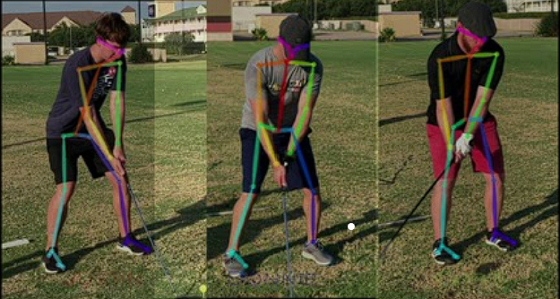
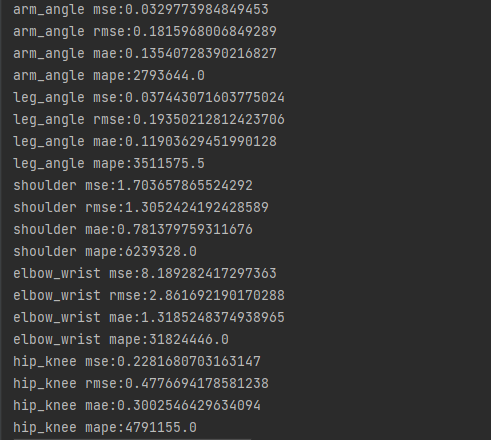
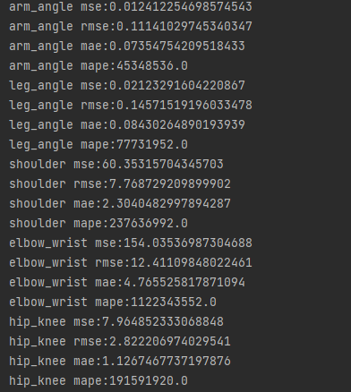

# Golf Swinging-Ai-Detection
### Descript:Golf swing position ai detection with openpose + lstm
### Environment: Python 3.7.0 + cuda 11.6

## Topic
Can Golf Swing Movements Be Predicted Like Stock Prices?

A golf swing is a continuous motion trajectory, which can even be represented using linear algebra. Given this characteristic, can it be modeled and trained similarly to how we predict stock prices?

Since LSTM (Long Short-Term Memory) networks are well known for their ability to capture temporal dependencies and patterns in time series data, we are interested in exploring whether their memorability has any impact on training and predicting such motion trajectories. Could LSTM's strength in time-series forecasting also apply to understanding and forecasting the dynamics of a golf swing?
## How does it work?
Record your seing video in front angle and give it to the Model,it will predict the correct body angle and body displacement.  
After that it will compare the predictive value with your actual value,and give you your score,which mean your swing is good or bad.  

_Dectection_  
  

_Compare_
| correct | wrong |
|-------|:-----:|
|  |  |

## Outlooking
Make it into a website and cooperate with the professional,through yuor video and result the professional coach can give you some advise.  
Through the website to get more and more database,to make it more powerful.  
